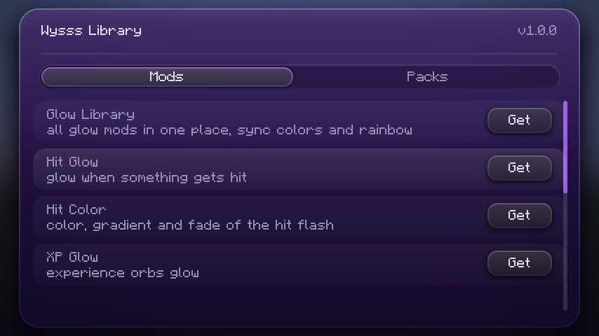
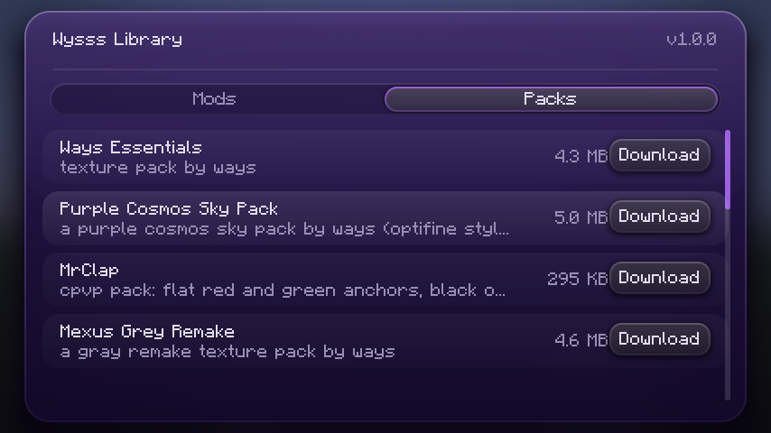

# Wysss Library

the library the menus of the other wysss mods need. client side fabric mod for 1.21.11, needs fabric api.

- **hub**: press **INSERT** to see all wysss mods, open their menus or get the ones you do not have
- **texture packs**: download and switch on the wysss texture packs from inside the game
- **settings kit**: purple glass menus with tabs, sliders, switches, color pickers and previews that the other mods use

## download

| jar | minecraft |
|---|---|
| `wysss-lib-mc1.21.11-1.0.0.jar` | 1.21.11 |

on the releases page.

## pictures

## license

all rights reserved, made by wysss.
